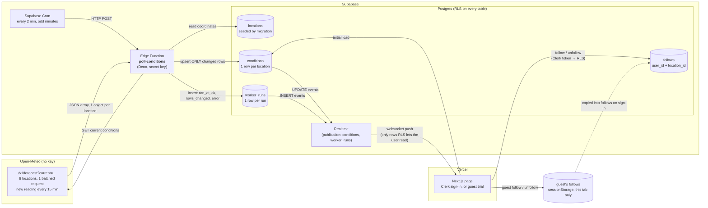

# Data flow: "Can I Play Right Now?"

Drafted before any code (Assignment 5, step 3). Live golf conditions for the Chicago courses and ranges from Assignment 4.

## What each part sends to the next

| From → To | What is sent | Shape |
|---|---|---|
| Cron → Worker | A trigger, nothing else | `POST /functions/v1/poll-conditions` |
| Worker → Open-Meteo | Comma-separated lat/lon for 8 locations | `current=temperature_2m,apparent_temperature,precipitation,rain,weather_code,wind_speed_10m,wind_gusts_10m,wind_direction_10m,is_day&daily=sunset` |
| Open-Meteo → Worker | An array with one object per location, **in the same order as requested** | `current.time` is the 15-min reading slot, e.g. `2026-11-01T23:45` |
| Worker → `conditions` | Only the locations whose values differ from what is stored | upsert on `location_id` |
| Worker → `worker_runs` | One row each run, whether it worked or failed | `ran_at, ok, rows_changed, source_time, error, duration_ms` |
| Realtime → Page | Each changed `conditions` row and each new `worker_runs` row | Postgres change payload |
| Page → `follows` | Which locations this person follows | `user_id` filled from the Clerk token, never sent by the app |
| Page → tab (guest) | A guest's follows, in `sessionStorage` | `["jackson-park", …]`. On sign-in they're upserted into `follows` (duplicates skipped), then cleared |

**Who can read what.** `locations`, `conditions` and `worker_runs` hold only public weather and worker health, so guests (the `anon` role, publishable key) can read them, including over Realtime. `follows` is signed-in only, with each person limited to their own rows. A guest's requests to it get `401 permission denied`.

## Freshness (two clocks)

- **Worker clock**: the latest `worker_runs.ran_at`. It shows the worker is alive. It should tick every 2 min.
- **Data clock**: `conditions.observed_at`, Open-Meteo's reading slot. It should advance every 15 min.

| State | Rule |
|---|---|
| Loading | Initial query hasn't returned yet |
| Fresh | Last run worked within ~6 min (3 runs) **and** the reading is less than 35 min old |
| Stale | No successful run in more than 6 min, **or** the reading is more than 35 min old (2 missed slots) |
| Down | The most recent `worker_runs` row has `ok = false` |

## What would break if one part changed

- **Open-Meteo reorders or drops a location**: the response has no ids, only order, so readings would land on the wrong course. The worker checks the count, and that each returned coordinate is within 0.1° of the one requested, before writing. Open-Meteo snaps coordinates to its grid, by up to 0.033° for these locations.
- **Open-Meteo renames a field** (e.g. `wind_gusts_10m`): the parsed value is `undefined`. The worker validates every field, so the run is recorded with `ok = false` and the page shows **Down** instead of blanks.
- **Worker rewrites every row each run**: Realtime would push about 8 messages to every open page every 2 minutes, even when nothing changed, which uses up the free quota. Saving only changed rows prevents that.
- **A table is left out of the Realtime publication, or its RLS read policy is missing**: the page silently gets nothing. Both are set in migrations.
- **Cron stops**: no new `worker_runs` rows arrive. The page uses its own timer to mark the data **Stale** after 6 min.

## Cadence and quotas

- Open-Meteo free tier: 10,000 calls/day. It isn't documented whether one 8-location request counts as 8 calls, so assume it does. Every 2 min is 720 runs × 8 = **5,760/day**. Every 1 min would be 11,520/day, over the limit.
- Supabase Edge Functions: 720 runs/day × 30 days = **21,600 of 500,000** monthly calls.
- New readings appear about 15 s after each 15-min mark, so the page lags the source by at most about 2 min.

## What the logs showed (first 8 hours, 242 runs)

- **4 failed runs, all from Open-Meteo.** Each was recorded in `worker_runs`, and the next run recovered.
  - **3 timeouts at exactly :00:10 past the hour** (21:00, 22:00, 00:00 UTC). Open-Meteo is slowest on the hour. The fix was to run on odd minutes (`1-59/2`) so the worker never polls at :00, and to raise its wait from 10 s to 20 s.
  - **1 `HTTP 429: Daily API request limit exceeded`** at 20:10 UTC, after only a few hundred of our calls. Most likely the limit counts per IP, and Edge Functions share outgoing IPs with other projects. We can't control that. The page shows **Down** with the error, and the next run fixes it.
- **Open-Meteo revises readings between its 15-min slots.** 32 runs saved changes while `current.time` stayed the same. That's about once per slot, at any minute, usually all 8 locations together. These are real changes from the source, so saving them is correct. It isn't a comparison bug: a bug would rewrite rows on every run, and runs with no change saved 0 rows.

